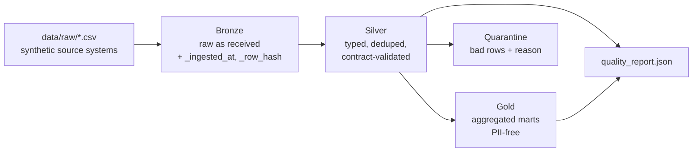

# dat-gov — Data Governance, Learned by Building It

A small, lightweight, fully working model of a governed data platform
for a fictional university, **Northbridge University**. No Spark, no
Airflow, no dbt, no cloud: Python 3.12 + DuckDB + PyYAML. Run one
command and you get a Bronze → Silver → Gold pipeline, data contracts
that actually fail bad rows, a quarantine you can inspect, a quality
report, a generated data catalog, and lineage — all on synthetic data
you can read and reason about.

This is a learning project. Every module has a docstring that names
the governance concept it demonstrates, and the docs explain each
decision with a concrete example from this repo.

## What it teaches

| Concept | Where to see it |
|---|---|
| Domain / subdomain ownership | `governance/owners.yaml` — one domain, four subdomains, named owners |
| Medallion architecture | `data/bronze/` raw-as-received, `data/silver/` cleaned + validated, `data/gold/` business marts |
| Data contracts | `governance/contracts/*.yaml` — schema, PK, not-null, ranges, formats, FKs |
| Data quality as a gate | `src/dat_gov/quality.py` → `data/quality_report.json`; `cli check` exits 1 on failure |
| Quarantine, not silent drops | `data/quarantine/*.parquet` with `_quarantine_reason` on every bad row |
| Data catalog | `governance/catalog/*.yaml` → generated `docs/catalog.md` |
| Lineage | `src/dat_gov/lineage.py` → `data/lineage.json` + `docs/lineage.md` (Mermaid) |
| PII classification + masking | `governance/policies/pii_policy.yaml`, `src/dat_gov/masking.py`; Gold has no raw PII |
| Access control | `governance/policies/access_roles.yaml` — 7 roles, dataset + masked-column lists |
| Retention | `governance/policies/retention_policy.yaml` — 7 years (10 for departments/courses) |

## Architecture



## Domain and subdomain map

Domain: **Higher Education** (Northbridge University), owner Chief Data Officer, Provost Office.

| Subdomain | Owner | Datasets |
|---|---|---|
| admissions | Director of Admissions | applicants, applications |
| registrar | Registrar | students, enrollments |
| academics | Dean of Academics | departments, courses, faculty, sections |
| finance | Bursar | tuition_charges, payments, financial_aid |

## Medallion layers

| Layer | Rule | Example |
|---|---|---|
| Bronze | Immutable copy of what arrived. Adds audit metadata only, never fixes a value. | A negative tuition charge and a bad email are preserved here |
| Silver | Typed, deduped, contract-validated. A row that fails is quarantined with a reason, never silently dropped. PII retained but classified. | 5,000 clean applicants from 5,120 raw; 120 quarantined |
| Gold | Aggregated business marts built only from Silver. No raw email, phone, gov_id or names. Totals reconcile to Silver. | Admissions funnel, enrolment, retention, finance, teaching load |

## Quickstart

```bash
python3 -m venv .venv
.venv/bin/pip install -e ".[dev]"
.venv/bin/python -m dat_gov.cli all
```

That runs the whole pipeline in about 8 seconds and prints a stage
summary. Then:

```bash
.venv/bin/python -m pytest -q        # 21 tests
.venv/bin/ruff check src tests scripts
.venv/bin/python -m dat_gov.cli check  # quality gate only
```

Inspect the outputs:

- `data/quality_report.json` — per-dataset Bronze/Silver/quarantine counts and check results
- `docs/catalog.md` — generated data dictionary (from the YAML + real Parquet schemas)
- `docs/lineage.md` — Mermaid lineage, Bronze → Silver → Gold
- `data/quarantine/applicants.parquet` — the bad rows, with reasons (try `SELECT _quarantine_reason, count(*) FROM read_parquet('data/quarantine/applicants.parquet') GROUP BY 1` in DuckDB)

## What a run looks like

On the reference run (seed 42, deterministic):

| Dataset | Raw | Silver | Quarantined |
|---|---|---|---|
| applicants | 5,120 | 5,000 | 120 (2.3%) |
| applications | 5,330 | 5,200 | 130 (2.4%) |
| students | 3,090 | 3,000 | 90 (2.9%) |
| enrollments | 12,300 | 12,000 | 300 (2.4%) |
| tuition_charges | 10,036 | 9,836 | 200 (2.0%) |
| payments | 6,150 | 6,000 | 150 (2.4%) |
| financial_aid | 2,060 | 2,000 | 60 (2.9%) |

Gold reconciles: funnel 5,200 applied → 3,452 admitted → 3,000
enrolled; finance billed $60,298,778 across 4 terms; Gold enrolment
total (12,000) equals Silver enrolments exactly.

## How to read the governance artefacts

- **A new dataset?** Add its contract + catalog YAML, add it to
  `governance/owners.yaml` and `config.DATASETS`, generate it, and the
  governance tests (`tests/test_governance.py`) will fail until all
  three exist. See the checklist in `docs/GOVERNANCE.md`.
- **A quality failure?** Open the quarantine file for that dataset,
  read `_quarantine_reason`, fix the source system, re-run. The
  pipeline never promotes a quarantined row.
- **"Where did this Gold number come from?"** Follow
  `docs/lineage.md` back to Silver, then to Bronze, then to the raw
  CSV named in `_source_file`.

## Repo layout

```text
src/dat_gov/        pipeline code (generate, ingest, transform_silver/gold, quality, masking, lineage, catalog, cli)
governance/         owners.yaml, catalog/*.yaml, contracts/*.yaml, policies/*.yaml
docs/               ARCHITECTURE.md, GOVERNANCE.md, DECISIONS.md, catalog.md + lineage.md (generated)
tests/              pytest suite (generation, bronze, silver, gold, governance, PII)
data/samples/       20-row samples per key dataset (committed; full data is generated, gitignored)
scripts/            run_pipeline.py (thin wrapper around the CLI)
.github/workflows/ ci.yml (ruff, pytest, full pipeline, artefacts)
```

## Docs

- [docs/ARCHITECTURE.md](docs/ARCHITECTURE.md) — layers, data flow, and why each piece exists
- [docs/GOVERNANCE.md](docs/GOVERNANCE.md) — each governance pillar, with a concrete example
- [docs/DECISIONS.md](docs/DECISIONS.md) — ADRs: why DuckDB not Spark, why YAML contracts, why synthetic data
- [docs/DATA_DICTIONARY.md](docs/DATA_DICTIONARY.md) — pointer to the generated catalog

## Notes

All people, emails, phones and government IDs are synthetic
(`example.edu`, `+1-555-…`, `NB-100000` style). No real personal data,
no secrets, no credentials anywhere in this repo.
