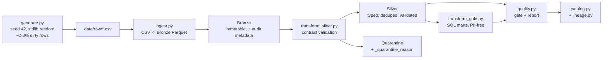

# Architecture

## The shape

One domain (Higher Education), four subdomains, eleven datasets,
three medallion layers, one CLI.

## Why this shape

- **One CLI, explicit stages.** `python -m dat_gov.cli all` runs
  generate → bronze → silver → gold → quality → catalog → lineage,
  printing row counts at each stage. Each stage is also runnable
  alone (`cli bronze`, `cli silver`, …), so you can re-run just the
  part you changed and see exactly what it did.
- **DuckDB as the engine.** It reads CSV and Parquet, runs the Gold
  SQL, and needs no server. The pipeline is a library you can import
  in a notebook, not a cluster you must operate. See DECISIONS.md.
- **Contracts as data, not code.** The Silver rules live in
  `governance/contracts/*.yaml`. The transform reads them; the
  quality gate re-reads them; the catalog renders them. Change a
  rule in one place and all three follow — that is the point.
- **Dependency order is explicit.** `config.DATASETS` lists datasets
  with FK targets first (departments before courses before sections
  before enrollments). Silver builds reference sets as it goes, so a
  foreign-key check can trust the dataset it points at.

## Data flow, dataset by dataset

| Dataset | Bronze rows | Silver rows | Notes |
|---|---|---|---|
| departments | 8 | 8 | Reference data; no dirty rows injected |
| courses | 41 | 40 | 1 duplicate quarantined |
| faculty | 82 | 80 | 1 duplicate + 1 bad email |
| sections | 123 | 120 | 1 duplicate + 2 invalid terms |
| applicants | 5,120 | 5,000 | Duplicates, null/bad email, future DOB |
| applications | 5,330 | 5,200 | Duplicates, invalid term, unknown applicant |
| students | 3,090 | 3,000 | Duplicates, future DOB, null email |
| enrollments | 12,300 | 12,000 | Duplicates, unknown course/student, invalid term |
| tuition_charges | 10,036 | 9,836 | Duplicates, negative amounts, unknown student |
| payments | 6,150 | 6,000 | Duplicates, negative amounts |
| financial_aid | 2,060 | 2,000 | Duplicates, negative amounts |

Gold marts (all built by SQL in `transform_gold.py`):

- `gold_admissions_funnel` — per term × program: applied, admitted,
  enrolled, admit rate, yield rate. From `applications`.
- `gold_enrollment` — per term × department × program: enrolments,
  distinct students, avg credits, completed/withdrawn. From
  `enrollments` + `students` + `courses`.
- `gold_student_retention` — per cohort year × program: cohort size,
  active/graduated/withdrawn, retention rate. From `students`.
- `gold_finance_summary` — per term: billed, collected (completed
  payments only), aid disbursed, net due. From `tuition_charges` +
  `payments` + `financial_aid`.
- `gold_faculty_teaching_load` — per faculty × term: sections taught,
  capacity, enrolled, credits taught. From `sections` + `courses` +
  `enrollments`.

## Where state lives

Generated data (`data/raw`, `bronze`, `silver`, `gold`,
`quarantine`, `quality_report.json`, `lineage.json`) is gitignored:
it is reproducible from the seed in seconds. Committed artefacts
are code, YAML governance, docs, tests, and `data/samples/` (20-row
samples so a reader can see the shape without running anything).
