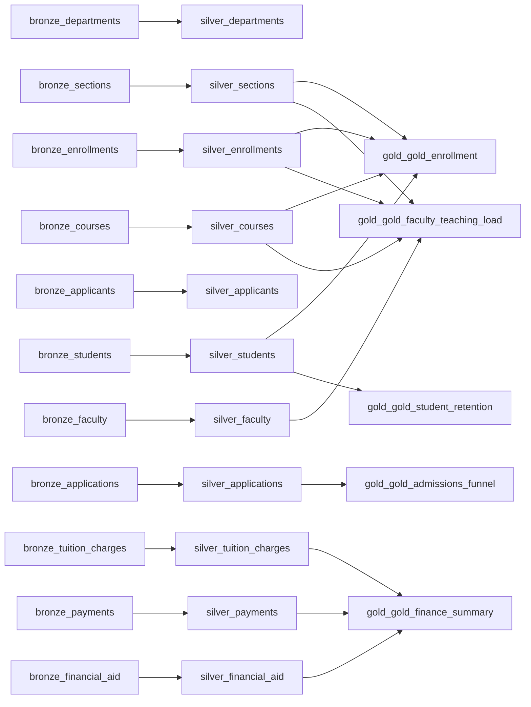

# Lineage

Generated from `src/dat_gov/lineage.py` — do not edit by hand.

## How to read it

Every Silver dataset has exactly one Bronze parent (its raw file). Every Gold mart lists its Silver sources in `GOLD_SOURCES`; change a Silver dataset and this graph tells you which Gold marts need re-running.
